<!-- ============================================================================
   CYBERPUNK GITHUB PROFILE - Sana-oss
   Neon noir terminal HUD for Sanad Alrigee
   NOTE: GitHub strips <style> blocks, style="" attributes and CSS animations
   from READMEs. All visuals here use GitHub-safe markup: SVG files in
   /assets (they animate on their own), shields.io badges and markdown tables.
   Keep the /assets folder next to this file.
   ============================================================================ -->
 

 

 

## `// OPERATIVE DATA`
 
| FIELD | VALUE |
| :-- | :-- |
| **HANDLE** | `SANAD ALRIGEE` |
| **CLASS** | `NETRUNNER / FULL-STACK DEV` |
| **REPUTATION** | `STREET CRED: 87 / 100` |
| **MEMORY ALLOC** | `16 GB RAM / 1 TB SSD` |
 
## `// QUICK UPLINKS`
 

 

## `// SYSTEM STATS`
 

## `// CYBERDECK HARDWARE`
 
**LANGUAGES** 

 
**FRAMEWORKS & PLATFORMS** 

 
**DATABASES** 

 
**TOOLS** 

 

## `// ACTIVE MISSIONS`
 
| MISSION | DIFFICULTY | STATUS | REWARD |
| :-- | :-- | :-- | :-- |
| [**Corinthia Discrepancy Reporting Tool**](https://github.com/Sana-oss/Corinthia-discrepancy-reporting-tool) | `HIGH` |  | `+500 XP` |
| [**POS Mahal**](https://github.com/Sana-oss/POS-Mahal) | `★★★☆☆` |  | `+300 XP` |
| [**Roster Craft Suite**](https://github.com/Sana-oss/Roster-Craft-Suite) | `★★★☆☆` |  | `+300 XP` |
| [**ZAD**](https://github.com/Sana-oss/ZAD) | `★★☆☆☆` |  | `+200 XP` |
| [**Booking for Ramadan**](https://github.com/Sana-oss/Booking-for-Ramdan) | `★★☆☆☆` |  | `+200 XP` |
 

## `// ACHIEVEMENTS UNLOCKED`
 
| BADGE | UNLOCK CONDITION |
| :-- | :-- |
| **First Boot** | Wrote your first line of code |
| **Glitch in the Matrix** | Fixed 50+ bugs |
| **Netrunner** | Merged 10+ PRs |
| **Data Dump** | Shipped 5+ projects |
| **Ramadan Runner** | Built Booking for Ramadan |
 

## `// LIVE TELEMETRY`
 

## `// ACCESS LOG`
 

The future is already here, it's just not evenly distributed. - William Gibson
 

 
